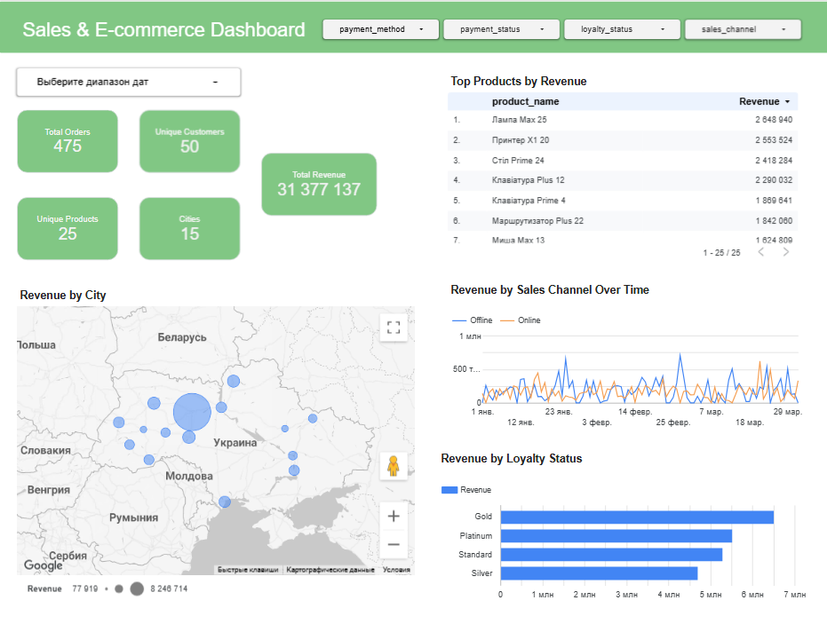

# Sales & E-commerce Dashboard

Dashboard interactivo de ventas y comercio electrónico desarrollado con SQL y Looker Studio.

## Objetivo del proyecto

Integrar los datos de ventas online y offline en un único dataset y crear un dashboard interactivo para analizar ingresos, pedidos, clientes, productos y canales de venta.

## Descripción del proyecto

Este proyecto consiste en el análisis y visualización de datos de ventas procedentes de dos canales:

- Ventas online
- Ventas offline

Los datos de ambos canales fueron integrados mediante SQL en un único dataset para poder analizar los resultados de forma conjunta en Looker Studio.

## Integración de datos

Para combinar la información de las dos fuentes se utilizaron:

- CTE
- JOIN
- UNION ALL
- Conversión y normalización de tipos de datos
- Creación del campo `sales_channel`

### Proceso de integración de datos

**Online Store + Offline Store → UNION ALL → Dataset combinado → Looker Studio**

## Resultados principales

El dashboard permite analizar los principales indicadores de ventas y comportamiento de los clientes.

- Ingresos totales
- Número total de pedidos
- Clientes únicos
- Productos únicos
- Ciudades de venta
- Ingresos por ciudad
- Ingresos según el nivel de fidelización
- Evolución de los ingresos por canal de venta
- Productos con mayores ingresos

## Dashboard

## Dashboard interactivo

Puedes consultar el dashboard interactivo en Looker Studio:

[Ver dashboard en Looker Studio](https://datastudio.google.com/reporting/79393d91-55d9-4bce-a713-035893786941/page/2Kt9F)

## Tecnologías utilizadas

- SQL
- PostgreSQL
- Looker Studio
- GitHub

## Estructura del proyecto

- `sales-ecommerce.sql` — consulta SQL para integrar las ventas online y offline.
- `dashboard.png` — captura del dashboard final.
- `README.md` — descripción y documentación del proyecto.
